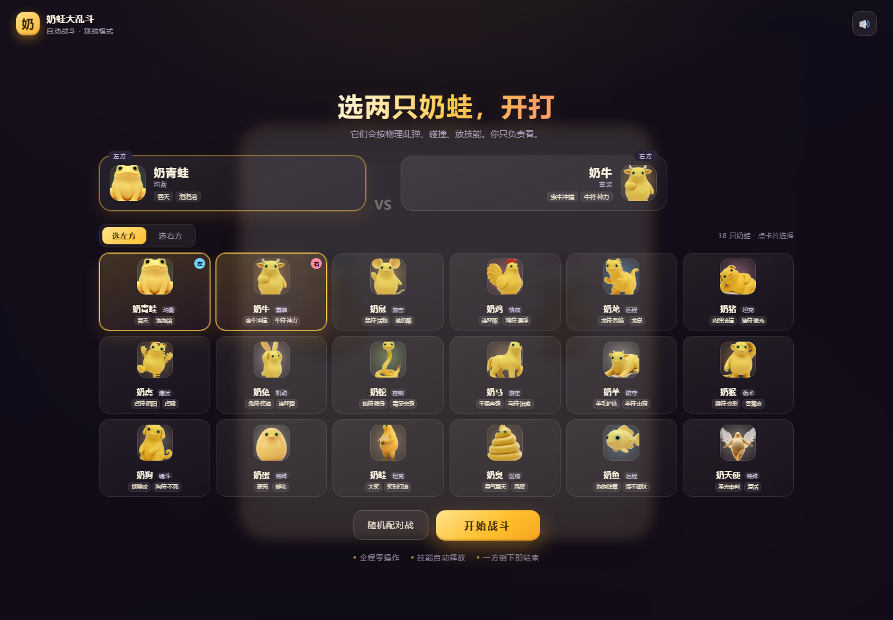
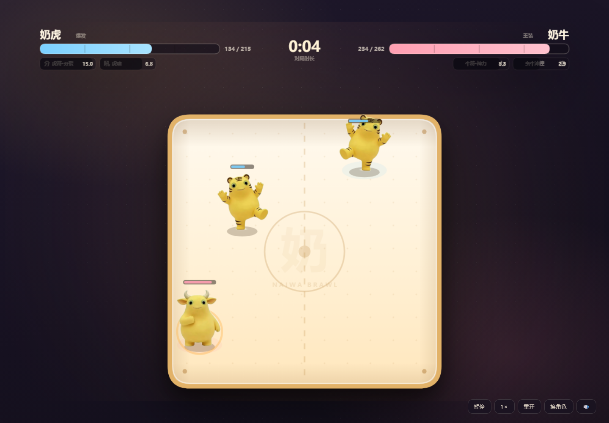
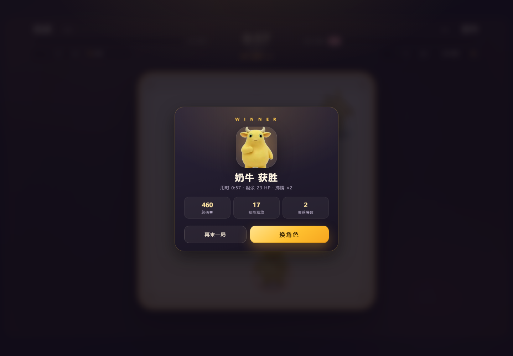

# 奶蛙大乱斗

斗蛐蛐式自动战斗小游戏。玩家只负责选两只奶蛙、点击开打，然后看它们在盆里按物理乱弹、碰撞、放技能，直到一方倒下。

技术栈：**Vite + TypeScript + Canvas 2D**，无后端、无运行时依赖。







---

## 运行

需要 Node.js 18+。

```bash
pnpm install     # 或 npm install
pnpm dev         # 或 npm run dev
```

打开终端提示的地址（默认 `http://127.0.0.1:5173/`）。

生产构建：

```bash
pnpm build       # 输出到 dist/
pnpm preview
```

> 如果 `pnpm install` 提示 `Ignored build scripts: esbuild`，不影响运行；若 Vite 无法启动，执行 `pnpm approve-builds` 允许 esbuild 即可。

---

## 玩法

1. 在 18 只奶蛙里给左、右各选一只（共享卡池，点「选左方/选右方」切换，也可以同角色镜像）；
2. 点「开始战斗」，倒计时 3 秒后自动开打；
3. 战斗中没有操作，只有暂停 / 2× / 重开 / 换角色；
4. 一方 HP 归零，播放 KO，结算后可以再来一局。

### 战场规则

- **正方形奶盆** 540×540，四周弹性墙，**没有出界淘汰**；上边界允许立绘探出，不会被裁掉。
- **所有角色体型一致**：碰撞半径统一 30，立绘按同一高度绘制（宽度随原画比例变化）。
- **只有技能能造成伤害**：碰撞、撞墙、普通攻击全部不掉血；冲锋类技能撞墙仍然会自晕。
- 为了补偿，技能基础伤害 ×1.75，范围、击退、屏幕震动和命中特效都整体放大。
- **不设时间上限**。第 40 秒起进入「奶气沸腾」：每 10 秒叠 1 层，造成伤害 +15%/层，治疗与护盾效果 -15%/层，用于保证再苟的局也会收束。
- 所有技能独立冷却，共享 0.4 秒施法间隔；技能选择按「保命 > 控制 > 输出」排序。
- **没有寻路、没有转向 AI**：开局只给一个朝向场地的初速度，之后方向完全由墙面反弹和两只身体的动量碰撞决定；马达只维持速度大小，不会改变方向。技能就绪且对手进入射程时才会停下施放。

### 战斗节奏

18 只按物理乱弹、纯技能输出：平均一局约 **55 秒**，中位数 55 秒，90% 的对局在 **71 秒**内结束，约 88% 的对局会进入沸腾阶段。

---

## 十二符咒（生肖角色）

十二只生肖奶蛙各自绑定一枚符咒，主技能就是符咒能力：

| 角色 | 符咒 | HP | 速度 | 符咒技能 | 第二技能 |
|---|---|---|---|---|---|
| 奶鼠 | 鼠符咒 | 258 | 205 | **活物**：召唤 14 血活鼠追着咬，打完才消失 | 偷奶酪：14 伤 + 偷攻击力 |
| 奶牛 | 牛符咒 | 262 | 112 | **神力**：7 秒内伤害 +30%、击退 +50% | 蛮牛冲撞：14 伤，撞墙自晕 |
| 奶虎 | 虎符咒 | 215 | 172 | **分裂**：分裂出另一只奶虎，两只独立血量 | 虎啸：8 伤 + 大击退 |
| 奶兔 | 兔符咒 | 275 | 205 | **疾速**：3.5 秒移速 ×1.8，撞人额外 6 伤 | 连环蹬：3 段共 31 伤 |
| 奶龙 | 龙符咒 | 250 | 138 | **烈焰**：火球命中或撞墙爆炸，18 伤 | 龙息：锥形持续伤害 + 灼烧 |
| 奶蛇 | 蛇符咒 | 240 | 158 | **隐身**：隐身 2.8 秒，下一次命中 +80% | 毒牙突袭：突进 + 蛇毒 |
| 奶马 | 马符咒 | 230 | 188 | **治愈**：3.2 秒回复共 15% 生命 | 回旋踢：扫一圈 16 伤 + 击退 |
| 奶羊 | 羊符咒 | 245 | 122 | **灵魂出窍**：2 秒无敌，出窍 200 范围 11 伤 + 灵魂灼烧 | 羊毛护体：32 点护盾 + 180 范围 10 伤 |
| 奶猴 | 猴符咒 | 225 | 198 | **定身**：把对手变小 2.5 秒，减速且不能放技能 | 香蕉皮：踩中滑倒 1.2 秒 |
| 奶鸡 | 鸡符咒 | 245 | 195 | **漂浮**：把对手飘到半空 1 秒，落地 8 伤 | 连环啄：3 段共 24 伤 |
| 奶狗 | 狗符咒 | 245 | 165 | **不死**：2.5 秒内血量不会低于 1，回 12% 血 | 锁喉咬：12 伤 + 定身 |
| 奶猪 | 猪符咒 | 265 | 112 | **激光眼**：320 距离激光，12 伤 + 灼烧 | 肉弹滚撞：霸体滚撞 |

## 其余角色（6 只）

| 角色 | 定位 | HP | 速度 | 技能一 | 技能二 |
|---|---|---|---|---|---|
| 奶青蛙 | 均衡 | 255 | 150 | **吞天**：吞人 1.1s，吐出 22 伤 | **泡泡浴**：3 个弹墙泡泡，7 伤 + 减速 |
| 奶蛋 | 特殊 | 275 | 145 | **硬壳**：减伤 75%，结束时炸壳 26 伤 | **孵化**：变成随机一只奶蛙 |
| 奶蛙 | 坦克 | 300 | 106 | **大笑**：回 6.5% 血 + 震退身边 8 伤 | **笑到打滚**：霸体滚撞 10 伤 |
| 奶臭 | 区域 | 265 | 142 | **臭气熏天**：大范围臭云 | **甩屎**：弹跳便便，落地留臭云 |
| 奶鱼 | 远程 | 235 | 185 | **深渊**：脚下漩涡拽人，收尾 11 伤 | **滑不溜秋**：38% 闪避 + 加速 + 回血 |
| 奶天使 | 特殊 | 225 | 152 | **圣光审判**：延迟光柱 18 伤 | **复活**：死亡时 30% 血复活一次 |

角色数值全部集中在 `src/game/chars.ts`，技能实现集中在 `src/game/skills.ts`，方便直接改。表格里的伤害是概述，具体数值以代码为准。

### 符咒机制

- **鼠·活物**：召唤一只有 14 点独立血量的活鼠，追着对手咬，被打完才消失；**没有数量上限**；
- **牛·神力**：7 秒增伤 + 击退增幅，配合冲撞能把人直接送进墙；
- **虎·分裂**：复制出另一只奶虎，两只各自独立血量，一只倒下另一只还能继续打；
- **兔·疾速**：纯速度爆发，起手震退周围 6 伤；
- **龙·烈焰**：会爆炸的火球，撞墙也炸，自己站太近也会吃伤害；
- **蛇·隐身**：半透明潜行，下一次命中直接 +80%；
- **马·治愈**：持续回血并清除灼烧/减速；
- **羊·灵魂出窍**：无敌 + 加速，撞到人额外掉血，是攻防一体的符咒；
- **猴·定身**：把对手缩小 2.5 秒，移速减半、不能放技能、受到伤害 +20%；
- **鸡·漂浮**：把对手抬到半空，落地再摔一次；
- **狗·不死**：2.5 秒锁血，怎么打都留 1 点；
- **猪·激光眼**：双目光束直线穿透，附带灼烧。

其他机制：吞人、弹墙投射物、臭云、蛋雷、护盾/反击/闪避、延迟打击、孵化/复活。

> 第 50 秒起全场每秒损失 1% 最大生命（真实伤害），防止高回复对局无限拖。

---

## 平衡验证

仓库带一个无头批量模拟器，跑所有角色组合并输出胜率矩阵、时长分布、卡死与出界统计：

```bash
pnpm sim          # 每对 10 场
pnpm sim -- 30    # 每对 30 场
```

当前 1026 场结果（18 只，每对 6 场）：

- 平均时长 53.8s，中位数 53.3s，P90 71.2s，最长 109.4s；
- 872/1026 场进入「奶气沸腾」，9 场平局，0 卡死、0 出界；
- 总胜率：奶青蛙 38.6%、奶牛 45.6%、奶鼠 61.4%、奶鸡 56.1%、奶龙 51.8%、奶猪 47.4%、奶虎 63.2%、奶兔 40.4%、奶蛇 45.6%、奶马 57.9%、奶羊 43.9%、奶猴 48.2%、奶狗 50.0%、奶蛋 38.6%、奶蛙 38.6%、奶臭 47.4%、奶鱼 64.9%、奶天使 52.6%。

> 纯技能输出后，攻击力现在只影响技能伤害，成了最直接的平衡旋钮。全部角色落在 **38.6% ~ 64.9%** 区间；奶鱼/奶虎/奶鼠偏高，奶青蛙/奶蛋/奶蛙偏低，下一轮单独调。

---

## 调试参数

URL 查询参数，方便截图 / 复现：

| 参数 | 说明 |
|---|---|
| `?auto=1` | 跳过菜单直接开打 |
| `&l=naiwa&r=nainiu` | 指定左右角色 id |
| `&seed=123` | 固定随机种子，同种子完全复现 |
| `&warp=12` | 开打前先快进 12 秒（截图 / 看中后期） |
| `&speed=2` | 初始 2 倍速 |
| `&debug=1` | 把角色坐标 / 状态写进页面标题 |

例：`http://127.0.0.1:5173/?auto=1&l=nailong&r=naizhu&seed=21&warp=15`

---

## 目录结构

```
src/
  core/      math / rng / 固定步长循环
  game/      chars(角色数值) skills(技能实现) world(战斗世界) constants types
  render/    assets(抠图/头像) renderer(Canvas 绘制)
  ui/        app(选人/流程/结果) sfx(WebAudio 音效)
  sim/       batch(无头批量对战)
public/chars/ 十八张角色原图
```

- 逻辑分辨率 1200×760，DPR 自适应；
- 固定步长 1/60，渲染帧独立；
- 战斗逻辑不依赖 DOM，可以直接在 Node 里跑批量；
- 随机数全部走种子 RNG，同种子可复现。

---

## 已知问题 / 下轮计划

- 18 人局 P90 约 71 秒，后续会继续压时长；
- 极端克制对局仍然存在，需要继续调技能数值；
- 场地边缘的高个立绘会被裁切（现在用内阴影+裁切遮掉了“飘出场外”）；
- 目前只有胜负结算，没有伤害曲线 / 战报；
- 菜单是 18 人共享卡池，后续加角色只需要往 `CHARS` 里追加数据。

---

## 部署到 GitHub Pages

仓库已经带好 `.github/workflows/deploy.yml`，推到 `main` 后：

1. 打开仓库 **Settings → Pages**；
2. **Build and deployment → Source** 选 **GitHub Actions**；
3. 回到 **Actions**，等 `Deploy to GitHub Pages` 跑完；
4. 地址是 `https://<你的用户名>.github.io/<仓库名>/`。

`vite.config.ts` 里 `base: './'`，项目页和自定义域名都能直接跑。

## License

代码以 **MIT** 协议开源，见 [LICENSE](LICENSE)。

`public/chars/` 里的角色立绘仅用于本项目展示，**不随 MIT 协议授权**；商用或二次分发前请先确认你拥有这些图片的权利。
